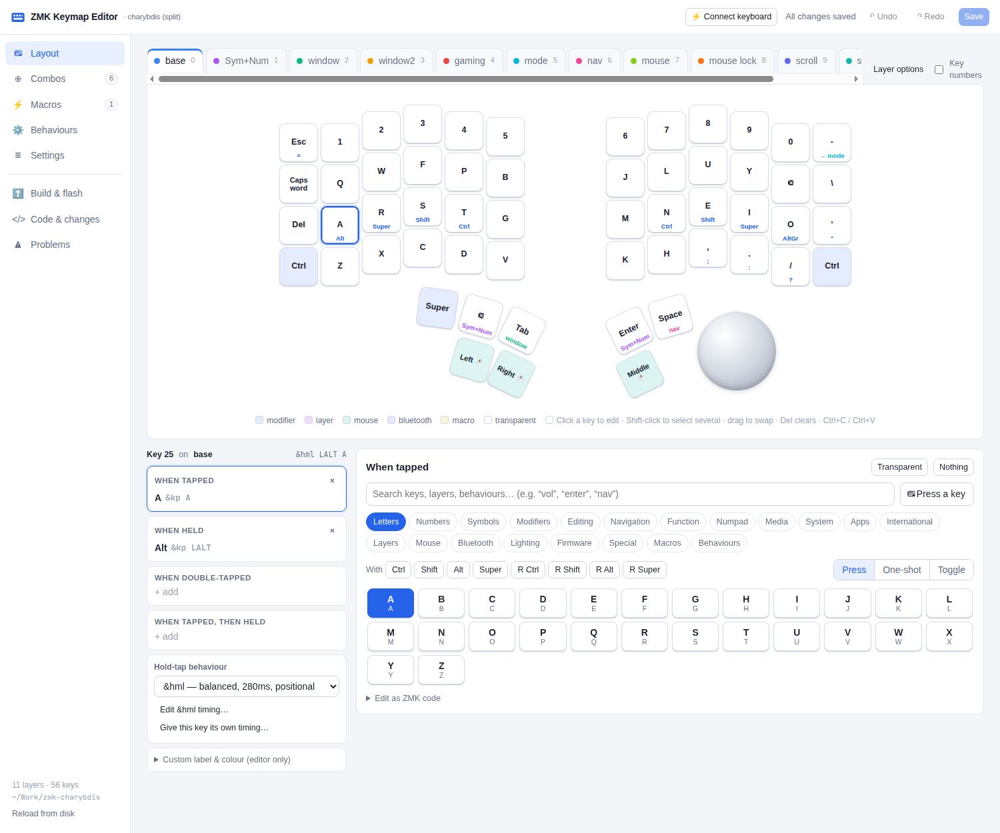

# ZMK Keymap Editor (v2)

A visual, Oryx-style configurator for ZMK keyboards. It edits the keymap, combos, macros,
behaviours and firmware settings of a `zmk-config` repository, checks the result against the
real ZMK headers, commits and pushes it so GitHub Actions builds the firmware, then flashes
it onto the keyboard. A live mode follows the keyboard's active layer over Raw HID.

Fork of [nickcoutsos/keymap-editor](https://github.com/nickcoutsos/keymap-editor). The
published upstream source is an old snapshot that only round-trips a `keymap.json` through a
template; this fork is a rewrite that edits real `.keymap` devicetree files. The ZMK keycode
data is upstream's (MIT). The key-editing model follows ZSA's Oryx (see
[docs/oryx-research.md](docs/oryx-research.md)).



## Run it

Needs Node.js 23.6+ (runs the TypeScript server directly) and a Chromium-based browser for
live mode.

```sh
npm install
npm run build
npm start -- --repo ~/path/to/zmk-config     # http://127.0.0.1:5185
```

`npm run dev` runs the same server with hot reload. The repository is remembered in
`~/.config/zmk-keymap-editor/settings.json`, so later `npm start` needs no arguments.

Optional extras:

- **Firmware check:** `server/setup-validator.sh` (or the button on *Build & flash*) fetches
  ~15 MB of ZMK and Zephyr headers into `~/.cache/zmk-keymap-editor`. Saving then runs the C
  preprocessor and Zephyr's devicetree parser and counts every layer's bindings, the way the
  firmware build does. It needs `python3` and `cpp`.
- **GitHub builds:** install and log in to the GitHub CLI (`gh auth login`) to follow
  Actions runs and download firmware from the editor.
- **Live mode on Linux:** add the udev rule in [docs/udev.md](docs/udev.md).

## What it does

**Keys, the Oryx way.** Every key has four steps: *tapped, held, double-tapped, tapped
then held*. The editor builds the ZMK binding for you and reuses your own behaviours where
they fit:

| Steps | ZMK binding |
|---|---|
| tap | `&kp A`, `&bt BT_SEL 1`, `&mo NAV`, a macro... |
| tap + hold modifier | `&mt LSHFT A`, or your own hold-tap (e.g. home-row mods `&hml LALT A`) |
| tap + hold layer | `&lt NAV SPACE` |
| tap + hold anything else | a hold-tap with matching bindings, created if needed (e.g. `<&to>, <&kp>`) |
| + tap-then-hold = the tap (key repeat) | the hold-tap with `quick-tap-ms` (e.g. `&u_lt_rep NUM BSPC`), no tap dance, so fast taps all register |
| + double tap / tap-then-hold | a tap dance whose bindings are the above |
| + 3rd, 4th… tap (each may have a hold) | a longer tap dance (ZMK only: Oryx stops at two taps) |
| + "When Shift is held" (or Ctrl/Alt/Gui) | a mod-morph wrapping all of the above (ZMK only) |

Tap dances, hold-taps and mod-morphs the editor generates are marked `// keymap-editor: generated` and
removed again once no key uses them. A key can get its own tapping term ("Give this key its
own timing") like Oryx's per-key tapping term.

**Beyond Oryx.** ZMK can do things Oryx can't, and the editor exposes them where you edit
keys and layers (marked *ZMK*):

- tap dances with any number of taps, each with its own hold action, and their own timing;
- a different key while a modifier is held (mod-morph), e.g. `,` that sends `;` with Shift
  or Backspace that sends Delete, optionally keeping the modifier;
- conditional (tri-)layers: a layer that switches on while two or more others are on
  (*Layer options → Turn on automatically*);
- positional hold-taps, require-prior-idle, hold-trigger-on-release, retro tap and
  hold-while-undecided on any hold-tap (*Behaviours*);
- **leader keys** (urob's `zmk-leader-key` module): press the leader, then type a sequence
  such as `B O O T` or `E P` to run any behaviour or macro. Sequences are recorded by typing
  them, and clashes and over-long sequences are flagged;
- **adaptive keys** (urob's `zmk-adaptive-key` module): a key that sends something else
  depending on the key typed just before it (and how recently), e.g. a Space that capitalises
  the next sentence, a Shift that repeats the previous letter, Hands Down-style rolls, or
  dead-key accents. Templates included;
- macros that pause until the key is released, key toggle, key repeat, sticky keys and
  layers, combos limited to layers, caps word with a custom continue list.

Creating a leader or adaptive key adds its module to `config/west.yml` (pinned to your ZMK
release), and the Problems page warns when a keymap uses a module that isn't loaded.

**Picking keys.** Categories, fuzzy search, a modifier row (`LC(LS(...))`), *Press a key*
capture, one-shot and toggle variants, layer actions, Bluetooth profiles, output, RGB
(including a colour picker), mouse buttons/movement/scroll, firmware keys, macros, and any
custom behaviour. *Edit as ZMK code* accepts any binding.

**Layers.** Add, rename, recolour, duplicate, clear, delete and drag to reorder. Every
reference follows: bindings, combos, conditional layers, `#define` layer names, and the
trackball's scroll/snipe and auto-mouse layers in the board overlay.

**Combos, macros, behaviours.** Pick combo keys on the keyboard. Macros support tap,
press and release steps, waits, pause-for-release and "type this text". Hold-taps, tap
dances and mod-morphs get documented property forms (flavour, tapping term, quick tap,
require-prior-idle, hold-trigger positions picked on the keyboard with *opposite hand*
presets). You can also override the built-in `&mt`, `&lt`, `&sk`, `&sl` and `&caps_word`.

**Settings.** An Oryx-style catalogue of Kconfig options (sleep, debounce, NKRO,
Bluetooth power, battery reporting, underglow, ZMK Studio), PMW3610 trackball options
(speed, sniping, rotation, inversion, polling), auto-mouse timing and mouse-key speeds. Each
setting shows where it is written (shield `.conf`, user `.conf`, keymap override, `#define`
or overlay) and its Oryx equivalent.

**Safety.** Problems are checked live (binding counts, unknown behaviours and keycodes,
layers out of range, unreachable layers, duplicate combos). Saving writes only the files
that changed. Untouched parts of the keymap are printed back verbatim, and overlays and
`.conf` files are patched in place, so diffs stay small. Undo and redo cover everything.

**Build & flash.** Commit and push the keymap files, follow the GitHub Actions run,
download the firmware and copy each `.uf2` onto the bootloader drive.

**Live mode** (Chromium WebHID). With the Raw HID modules used by
[zmk-charybdis](https://github.com/fubartutu/zmk-charybdis)'s visualiser (`zmk-raw-hid`,
`zmk-keypeek-layer-notifier`, `modules/status-report`), the editor follows the active
layer, highlights pressed keys, lets you **select a key by pressing it on the keyboard**,
and shows both halves' batteries and the Bluetooth profile.

## Keyboard layouts

The display layout comes from, in order: a bundled layout in `keyboards/*.json` (the
Charybdis 4x6 uses the geometry of zmk-charybdis' visualiser), the shield's ZMK physical
layout (`key_physical_attrs`), an `info.json`, or a plain grid. Add a file to `keyboards/`
for a nicer picture of your board.

## Development

```sh
npm test          # vitest: parser round-trips, composer, layer moves, settings, visualiser compatibility
npm run typecheck
```

`src/core` has no UI code: the devicetree parser and printer (`dts.ts`), the keymap model
(`keymap.ts`), the Oryx-style composer (`composer.ts`), combos, macros and behaviours
(`features.ts`), settings (`settings.ts`, `settingsio.ts`), overlays (`overlay.ts`) and
validation (`validate.ts`). `server/` holds the local API (file I/O, git, `gh`, flashing,
firmware check). `src/ui` is the React app.

Tests run against a pinned snapshot of `~/Work/zmk-charybdis` (`FIXTURE_REV` in
`tests/fixture.ts`, extracted with `git archive`), so editing your keymap doesn't break them.
They are skipped if that clone or commit isn't there. `$ZMK_CONFIG` points them at another directory.

## Limitations

- Keymaps generated by preprocessor macros (e.g. Miryoku) load and save, but layers built
  from macros can't be edited visually.
- Sensor (encoder) bindings are kept but have no editor.
- The firmware check validates the devicetree and binding counts, not Kconfig. A full
  build still happens on GitHub.
